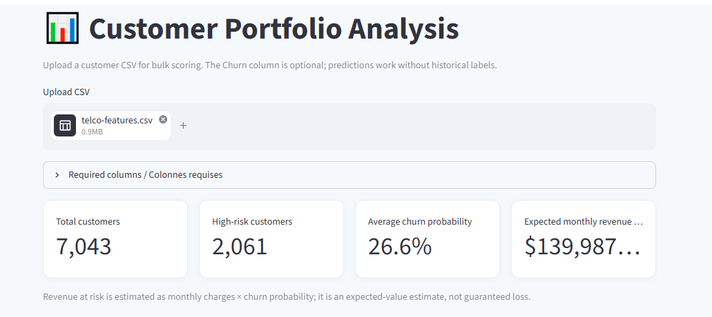
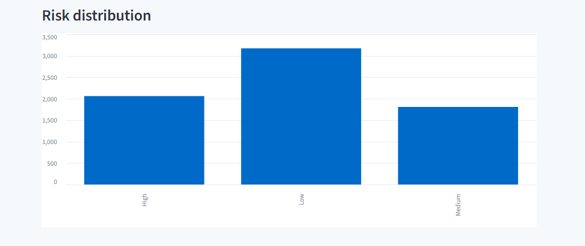
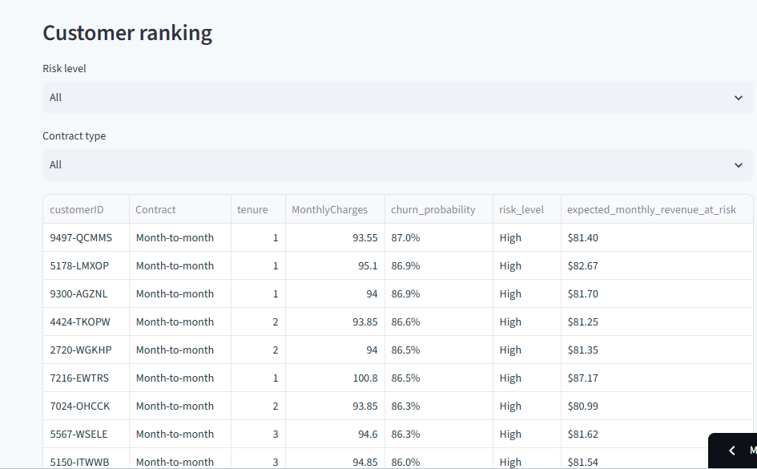
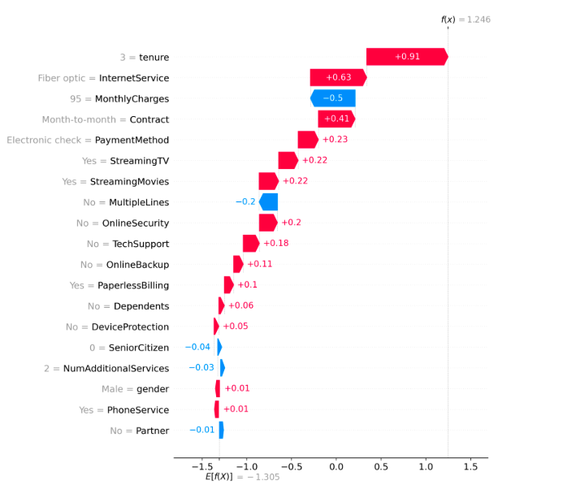
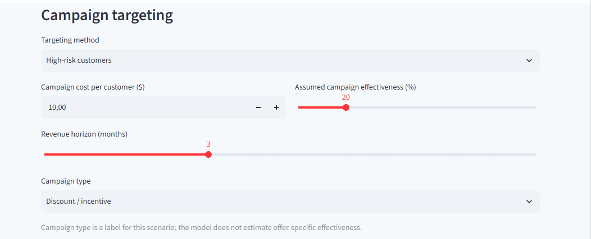
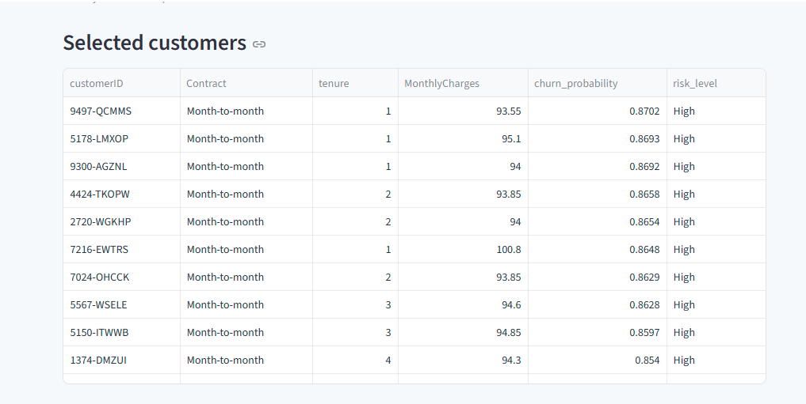

# Telco Customer Churn Prediction & Retention Analytics

A machine-learning application that predicts customer churn, explains individual predictions, and helps explore retention strategies through customer portfolio analysis and a campaign simulator.


## Live application and repository

- **Live app:** https://telco-customer-churn-mmehdi2.streamlit.app/
- **GitHub repository:** https://github.com/mmehdi30/telco-customer-churn

## Business problem

Customer churn directly affects recurring revenue. The goal of this project is to use customer data to identify customers who may be at risk of leaving, understand the factors contributing to their predicted risk, and support retention planning with actionable analysis.

The app is designed to support analysis—not to replace business judgment or prove that a particular retention offer will prevent churn.

## Dataset

The project uses the IBM Telco Customer Churn dataset, containing **7,043 customer records**. The target variable is `Churn`.

The dataset includes customer demographics, account tenure, services, contract details, billing, and payment information.

## Machine-learning workflow

1. Data inspection and cleaning
2. Exploratory data analysis
3. Feature engineering, including `NumAdditionalServices`
4. Encoding and preprocessing for model inputs
5. Logistic Regression model training
6. Out-of-fold prediction-based threshold selection to optimize the F1 score
7. Evaluation on a held-out test set
8. Model explainability with SHAP

## Model performance

The final test-set metrics recorded for this model are:


| Metric | Score |
|---|---:|
| ROC-AUC | 0.839 |
| Accuracy | 0.7594 |
| Precision (Churn) | 0.5351 |
| Recall (Churn) | 0.7139 |
| F1-score (Churn) | 0.6117 |


The selected classification threshold prioritizes a balance between precision and recall, with particular attention to detecting customers who churn.

## Application features

### 1. Individual churn prediction

Enter customer details to obtain a churn probability and risk assessment.

### 2. Explainable predictions

SHAP is used to explain model output and highlight the features that push an individual prediction toward or away from churn. Explanations are intended to improve transparency, not to establish causality.

### 3. Retention recommendations

The application provides rule-based retention suggestions. Recommendations are prioritized using model explanation signals and business rules; they are heuristics, not causal or experimentally validated treatment recommendations.

### 4. Customer portfolio analysis

Upload a CSV containing customer records to score a customer portfolio in bulk. The churn label is optional: the workflow can score customers even when historical churn outcomes are not provided. The portfolio view includes risk distribution, customer ranking, risk filters, and exportable results.

### 5. Retention campaign simulator

Explore hypothetical retention campaign scenarios by adjusting targeting, campaign cost, assumed effectiveness, revenue horizon, and campaign type. The simulator is an estimation tool based on assumptions; it does not represent measured campaign results or guarantee savings.

## Screenshots

### Customer portfolio overview

Portfolio KPIs and bulk scoring overview.



### Risk distribution

Overview of customers grouped by predicted risk level.



### Customer ranking

Filter and inspect customers ranked by churn probability and estimated monthly revenue at risk.



### SHAP explanation

An example explanation showing feature contributions for an individual prediction.



### Campaign targeting

Adjust the hypothetical campaign assumptions and targeting strategy.



### Selected customers

Review the customers selected by the campaign scenario.



## Tech stack

- Python
- Pandas and NumPy
- Scikit-learn
- SHAP
- Streamlit
- Matplotlib
- Joblib

## Project structure

```text
.
├── app.py
├── predict.py
├── explain.py
├── retention.py
├── portfolio.py
├── campaign_simulator.py
├── translations.py
├── models/
│   ├── telco_churn_model.pkl
│   ├── model_features.json
│   ├── model_config.json
│   └── shap_background.csv
├── notebooks/
│   └── notebook.ipynb
├── docs/
│   └── images/
├── requirements.txt
└── README.md
```

## Run locally

1. Clone the repository:

   ```bash
   git clone https://github.com/mmehdi30/telco-customer-churn.git
   cd telco-customer-churn
   ```

2. Create and activate a virtual environment:

   ```bash
   python -m venv .venv
   ```

   Windows PowerShell:

   ```powershell
   .\.venv\Scripts\Activate.ps1
   ```

   macOS/Linux:

   ```bash
   source .venv/bin/activate
   ```

3. Install dependencies:

   ```bash
   pip install -r requirements.txt
   ```

4. Launch the application:

   ```bash
   streamlit run app.py
   ```

## Limitations

- The model is trained on a historical dataset and may not generalize to every business or customer population.
- Predicted churn probability is a model estimate, not a certainty.
- SHAP describes how features contribute to the model output; it does not establish causal relationships.
- Retention recommendations are rule-based heuristics and are not validated through experiments.
- Campaign simulator outputs depend on user-defined assumptions and should be interpreted as hypothetical estimates.

## Future improvements

- Evaluate model calibration and monitor performance over time.
- Test alternative models and compare them using business-relevant metrics.
- Validate retention actions through controlled experiments or A/B tests.
- Incorporate real campaign outcomes and cost data into the simulator.

## What I learned

- Building an end-to-end churn prediction workflow, from data preparation to deployment.
- Evaluating classification models with metrics beyond accuracy, especially recall and F1 for churn detection.
- Applying feature engineering and threshold optimization.
- Using SHAP to interpret model predictions.
- Turning model output into a practical analytics workflow through bulk scoring, customer ranking, and scenario simulation.
- Deploying a machine-learning application with Streamlit.


---

**Author:** Mehdi Merzouki
